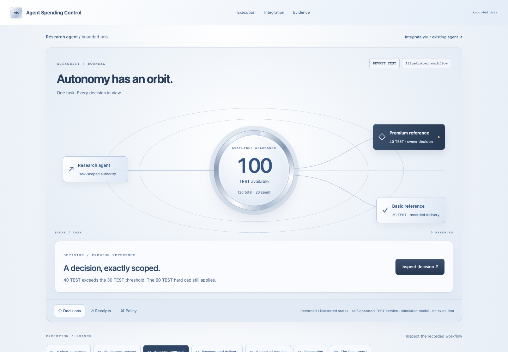

# Agent Spending Control

**Spending guardrails for agents that use paid tools.**

Give an agent a bounded allowance, require owner approval for exceptions, and
track each request from authorization through payment and delivery. Integrate
one governed tool into an existing agent without replacing its framework or model.

[Public demo](https://agent-spend-control-replay.vercel.app) ·
[Integration guide](docs/INTEGRATION.md) · [API reference](docs/API.md) ·
[Architecture](docs/ARCHITECTURE.md)

> Developer preview. The public demo is a read-only replay. It uses recorded
> Devnet payments, a self-operated TEST token and reference service, and explicitly
> simulated model output. It cannot approve purchases or spend funds.



## Features

- **Task-scoped authority:** separate owner and agent credentials, credential
  rotation, workspace isolation and recipient/provider/tool allowlists.
- **Enforced limits:** total and per-request allowances, expiry and call quotas.
  Solana token transfers are restricted by a program-controlled vault.
- **Exact approvals:** purchases above a configured threshold wait for the owner.
  Approval applies to a specific payload and policy version and cannot bypass
  hard limits.
- **Durable execution:** PostgreSQL reservations, payload-bound idempotency,
  persisted dispatch attempts and reconciliation after uncertain responses.
- **Independent outcomes:** confirmed charges and service delivery are recorded
  separately; a failed delivery does not erase an already-confirmed payment.
- **Operator console:** an interactive spending orbit, allowance inspection, approval inbox, request timeline, receipts,
  reports, pause/revoke controls and an Integration workspace.
- **TypeScript integration:** submit a governed purchase, wait for its outcome,
  notify the owner when approval is needed, and resume the same request after a
  client timeout.

## How it works

```text
Existing agent → task-scoped SDK → gateway policy check → durable reservation
                                      │
                                      └→ owner approval, when required
Worker → restricted vault payment → paid service → delivery receipt
                                      │
Private operator console ← usage ledger and reconciliation
```

The agent submits an intent; the trusted worker executes supported adapters.
External agents need only a task-scoped credential, without owner wallets,
database access or approval authority. The bundled research workflow runs inside
the trusted worker and uses a transactional store port. Owner signing remains
in a separate component. Only requests routed through these policy and adapter
paths are governed. It does
not control unrelated API keys, wallets or tool calls an agent already holds.

## Quickstart

Requires Node.js 22.12+ and npm. The public replay needs no wallet, API key,
database or Solana toolchain.

```sh
npm ci
npm run replay:dev
```

Open the printed URL, normally `http://127.0.0.1:5176`. To generate the standalone
static site:

```sh
npm run replay:build
```

The output is `apps/replay/dist`. Only this replay is suitable for anonymous
public hosting; keep the operator console and signing processes private.

## Integrate an existing agent

The current adoption path starts with the included research agent as an
**internal integration pilot**, then one external developer. Prove the allowed →
approval → settlement flow and test recovery before broadening onboarding.
Broad self-service signup and public execution are outside this milestone.

### 1. Start a private test environment

Install PostgreSQL 17, Rust and the Solana CLI, then build and launch:

```sh
npm run vault:build
PG_BIN=/opt/homebrew/opt/postgresql@17/bin npm run local:demo -- --new-task
```

Omit `PG_BIN` when PostgreSQL binaries are on PATH. The launcher starts its own
local services and provisions a bounded, funded TEST task. Existing database,
ledger and wallet state are retained. See [local setup](docs/LOCAL_DEMO.md) for
prerequisites, platform configuration and private sign-in instructions.

Open the private dashboard and choose **Integration**. Select the provisioned
task to inspect its policy/binding readiness, setup instructions and requests.
For the internal pilot, use **Run research** in Overview, approve premium and
read the simulated report and separate payment/delivery receipts. For your own
agent, provision a separate task and leave its built-in workflow idle.

### 2. Configure the agent process

The operator supplies these values privately:

| Variable | Purpose |
|---|---|
| `SPEND_GATEWAY_URL` | Reachable private gateway origin; never the public replay URL |
| `SPEND_TASK_ID` | The provisioned task ID |
| `SPEND_AGENT_TOKEN` | Credential scoped to that task |
| `AGENT_OPERATION_ID` | Stable job/tool-operation ID persisted across retries |

Copy [the environment template](examples/existing-agent/agent.env.example) to
ignored `.env.agent.local` and configure it locally. Never put an owner credential
or wallet in this file or in model context.

### 3. Wrap the paid tool

The SDK and example are currently source-local, not published npm packages.
From the repository root:

```ts
import { SpendingClient, referenceTool } from './packages/sdk/src/index.js';

const client = new SpendingClient(
  process.env.SPEND_GATEWAY_URL!,
  process.env.SPEND_AGENT_TOKEN!,
);
const buyReference = referenceTool(client, process.env.SPEND_TASK_ID!);

const result = await buyReference({
  operationId: 'persisted-job-123/basic',
  dataset: 'basic',
  topic: 'Safe spending on Solana',
});

// Inspect both execution state and settled delivery before using the result.
if (result.request.state === 'succeeded' && result.usage?.delivery === 'delivered') {
  const evidence = result.usage.receipt;
}
```

Run the standalone example with the same private configuration:

```sh
npm run agent:reference -- basic
# Use a distinct persisted operation ID for this distinct purchase:
npm run agent:reference -- premium
```

The reference prices are 20 TEST for basic and 40 TEST for premium. With the
sample task's 30 TEST threshold, premium waits for owner approval in the console.
The example calls no model API. Custom services require a trusted adapter;
this is not an unrestricted payment or arbitrary-HTTP proxy.

A timeout ends the client's wait, not the purchase. Reuse the **same operation
ID and exact input** to resume. A new purchase needs a new operation ID. See
[the integration guide](docs/INTEGRATION.md) for the full lifecycle and failure
handling.

### Included research-agent integration

The [research workflow](examples/reference-agent/workflow.ts) routes its basic
and premium purchases through [`submitReference`](packages/sdk/src/reference-tool.ts).
It preserves its durable request keys, exact approval payload and report evidence.
Because it runs inside the trusted worker, it supplies a transactional store port
and resumes through durable workflow ticks; it does not make HTTP calls or wait
for approval while holding database locks. External agents use the same tool
contract through the task-scoped SDK client and bounded waiter.

## Execution modes

| Mode | Payments / service | Model |
|---|---|---|
| Public replay | Recorded Devnet evidence; illustrative blocked/revocation scenes | Explicitly simulated |
| Fixture workflow | Synthetic charges and results | Synthetic |
| Local validator | Actual local SPL transfers and self-operated reference delivery | Simulated when using built-in research |
| Devnet demo | Actual Devnet TEST transfers and self-operated reference delivery | Simulated when using built-in research |
| Live model adapter | Implemented and mock-tested; provider billing is separate | Actual calls remain disabled and unauthorized |

The Devnet program is already deployed and verified; [deployment and authority](docs/deployments/devnet.json)
and [payment evidence](docs/deployments/devnet-workflow.json) are recorded.
Do not redeploy or reset state to start another demo.

## Development and testing

```sh
npm run check           # TypeScript
npm test                # Policy, credentials and adapter tests
npm run web:build       # Private operator console
npm run test:replay     # Production replay in real Chrome
npm run test:postgres   # Isolated PostgreSQL lifecycle/HTTP tests
npm run test:integration # Isolated PostgreSQL + Solana end-to-end tests
```

Database tests require PostgreSQL binaries on PATH or `PG_BIN`.
Chain integration tests require the Solana toolchain and a built vault binary.
Browser tests use installed Chrome; set `CHROME_PATH` on other platforms.
`npm run test:browser` exercises an active local demo and revokes its task;
seed a fresh task explicitly before repeating it.

## Repository structure

| Path | Responsibility |
|---|---|
| `apps/gateway` | Authentication, policy checks and durable request API |
| `apps/worker` | Adapter execution and reconciliation |
| `apps/owner` | Separate owner-authorized chain signing |
| `apps/reference-service` | Self-operated paid reference service |
| `apps/web` | Private operator console |
| `apps/replay` | Public static demonstration |
| `packages/sdk` | TypeScript client and request waiting |
| `programs/spending-vault` | Anchor vault restrictions |
| `examples/existing-agent` | Tool wrapper for an existing agent |

## Security and limitations

Owner-key sign-in is a developer bootstrap, not production account recovery or
SSO. The owner-signing process trusts the operator database; host/database
compromise is outside the current protection boundary. Tenant checks are tested,
but public live-session isolation is not implemented. Do not expose the developer
console anonymously or use this preview for real funds.

Token allowances do not cap model-provider dollar billing. Network fees and
receipt-account rent are separate from TEST spending. Billable OpenAI calls remain
disabled. x402 compatibility is not claimed. The SDK is source-local; a real
external developer adoption pilot and additional service adapters remain work
in progress.

## Documentation

- [Developer integration](docs/INTEGRATION.md)
- [HTTP API and SDK](docs/API.md)
- [Architecture and trust boundaries](docs/ARCHITECTURE.md)
- [Local and Devnet demo setup](docs/LOCAL_DEMO.md)
- [Hosted delivery](docs/HOSTING.md)
- [Demonstration script](docs/DEMO_SCRIPT.md)
- [Implementation status and next actions](docs/STATUS.md)
