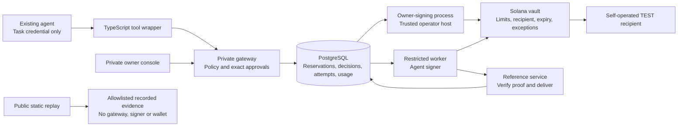

# Agent Spending Control — hackathon submission

**Bounded spending authority for agents that use paid tools.**

[Submission and working video](https://agent-spend-control-replay.vercel.app/submission.html) ·
[Open the public experience](https://agent-spend-control-replay.vercel.app) ·
[Repository](https://github.com/Andromeda-crypto/agent-spend-control) ·
[Developer integration](INTEGRATION.md)

## Pitch

An agent needs a paid tool. Giving it a wallet or API key grants more authority
than the task needs. Agent Spending Control lets an owner grant one task a
bounded allowance, approved recipient and expiry. Ordinary purchases proceed;
exceptions pause for approval of the exact purchase. Hard limits still apply.
A restricted Solana vault executes supported token payments, while a durable
ledger records payment and service delivery independently. Integrate one tool
into an existing agent without replacing its framework or model.

## Working demonstration

The research agent has 120 TEST, a 60 TEST per-request cap and approval above
30 TEST. A 20 TEST basic reference proceeds. A 40 TEST premium reference pauses
for the owner, then settles and delivers. A 61 TEST request is blocked. Revoking
the task prevents new work, while prior payments remain recorded. The resulting
research report is simulated.

Use the public Orbit replay for inspection. The working recording documents
local-validator execution; public Devnet receipts are separate recorded proof.
[Presenter script and fresh-task procedure](DEMO_SCRIPT.md).

## Architecture

Owner approval binds amount, recipient, scope and policy version. The worker
persists signed attempts before submission and reconciles uncertain outcomes
instead of blindly paying again. Confirmed charges survive failed delivery.
The owner signer trusts operator database decisions; it does not independently
protect against a compromised operator host/database.

## Verifiable evidence

- [Existing Devnet deployment and authority](deployments/devnet.json).
- [Two finalized Devnet payments](deployments/devnet-workflow.json).
- [Basic 20 TEST payment on Solana Explorer](https://explorer.solana.com/tx/588T4pXQEqmAdV36VUE5RMwdy1yfTSi2DPeaxPnTw7vXVxNgUT1DwQQ1QnDh92Vd2DZvmx6JKJnXrj9tZjQBaJc9?cluster=devnet).
- [Premium 40 TEST payment on Solana Explorer](https://explorer.solana.com/tx/4FRPECduD4baMPKGNWh6c3HoFedBBLmsZJqpfxRaercuT9XgpPCgQBSNEMYiAb3GccsbRQ6xNobr8h4vyrXdE14J?cluster=devnet).
- [Browser verification](BROWSER_QA.md), [release record](deployments/public-replay.json),
  [source tests](../test) and [GitHub CI](https://github.com/Andromeda-crypto/agent-spend-control/actions).

## What is real, simulated and remaining

| Part | Actual scope |
|---|---|
| Solana vault | Deployed on Devnet; restrictions tested on a local validator |
| Payment evidence | Two recorded finalized Devnet TEST transfers |
| Working walkthrough | Actual local-validator TEST transfers and reference delivery |
| Token and service | Self-operated TEST token/service; no implied monetary value |
| Model and report | Simulated; no billable OpenAI calls authorized or made |
| Public experience | Read-only replay; approval/block/revoke phases are illustrations |
| Integration | Internal research agent plus a separate-process agent client |
| Independent adopter | Not yet verified; handoff and acceptance protocol prepared |

Developer preview only: no mainnet funds, production account recovery, public
live-session isolation or independent security audit. TEST budgets do not cap
model-provider dollar billing or SOL network/rent costs. No x402 compatibility
is claimed. Docker runtime and backup/restore still need verification.

## Reproduce or integrate

For a wallet-free first look: `npm ci && npm run replay:dev`.
For the private working flow, follow [LOCAL_DEMO.md](LOCAL_DEMO.md).
For one agent/one tool, use [INTEGRATION.md](INTEGRATION.md) and the
[independent developer handoff](PILOT_HANDOFF.md). Keep credentials private;
only the operator approves and signs. Preserve existing Devnet state.
